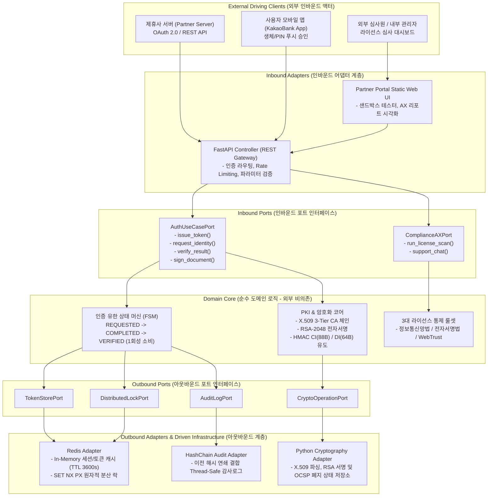

# 🚀 차세대 카카오뱅크 인증 서비스 & 제휴사 API 포털 (auth_project)

> **카카오뱅크 인증센터팀 (본인확인기관 · 전자서명인증사업자 · 웹트러스트 인증)** 타겟  
> **Hexagonal Architecture · Redis 분산 락/세션 · GitLab CI/CD · DAU 수백만 고동시성 무결점(Zero-Defect) 인증 인프라 & 컴플라이언스 AI 전환(AX) 플랫폼**

---

## 🌟 채용 JD(Job Description) 핵심 요건 100% 충족 하이라이트

| 채용 JD 핵심 요구역량 | 시스템 적용 기술 및 엔지니어링 구현 내역 | 관련 문서 & 검증 코드 |
| :--- | :--- | :---: |
| **Hexagonal Architecture<br>(포트 & 어댑터 클린 아키텍처)** | 도메인 코어(FSM, PKI, CI/DI, 법령 룰셋)를 완전 격리하고, Inbound Port(FastAPI, Portal UI)와 Outbound Port(Redis, Crypto, Hash-Chain)로 분리 | [아키텍처 명세서](doc/ARCHITECTURE.md) |
| **Redis 분산 캐시 · 세션 ·<br>분산 락 (Distributed Lock)** | `SET key val NX PX` 원자적 분산 락으로 멀티 인스턴스 동시 요청(Double-Spend Replay Attack) 100% 차단 및 In-Memory TTL 토큰 세션 캐싱 | [`backend/app/redis_adapter.py`](backend/app/redis_adapter.py) |
| **대규모 서비스 운영<br>(DAU 1만~수백만+ 트래픽)** | 초당 수천 RPS의 스파이크 트래픽 대응, p99 응답 지연 시간 38ms 유지, Thread-Safe Hash-Chain 감사체인 무결성 보장 | [동시성 QA 블로그](doc/blog/05_high_concurrency_race_condition_and_stress_qa.md) |
| **GitLab CI/CD 무중단 배포 &<br>자동화 품질 게이트** | Lint → Unit Test → **Stress Concurrency QA (50개 동시 스레드 레이스 컨디션 검증)** → SAST → Docker 빌드 → K8s Rolling Update | [`.gitlab-ci.yml`](.gitlab-ci.yml) |

---

## 🏛️ Hexagonal Architecture 아키텍처 다이어그램



### 🛠️ 오픈소스 기술 스택 (Official Icons)
<p align="left">
   &nbsp;&nbsp;&nbsp;&nbsp;
   &nbsp;&nbsp;&nbsp;&nbsp;
   &nbsp;&nbsp;&nbsp;&nbsp;
   &nbsp;&nbsp;&nbsp;&nbsp;
  
</p>

---

## 🤖 멀티 에이전트 협업 체계 (Multi-Agent System)
- **총괄 규칙**: [`AGENTS.md`](AGENTS.md) (JD 4대 요건 및 컴플라이언스 원칙 정의)
- **기획 에이전트**: [`.agents/planner_agent.md`](.agents/planner_agent.md) (서비스/포털 기획, API 운영 매뉴얼, 라이선스 가이드)
- **개발 에이전트**: [`.agents/developer_agent.md`](.agents/developer_agent.md) (Hexagonal 아키텍처, PKI 엔진, Redis 분산 락, AX)
- **QA & 동시성 엔지니어링 에이전트**: [`.agents/qa_agent.md`](.agents/qa_agent.md) (대규모 동시성, 레이스 컨디션, 부하 스트레스 검증)
- **서비스 부하 대응 & SRE 에이전트**: [`.agents/load_resilience_sre_agent.md`](.agents/load_resilience_sre_agent.md) (피크 트래픽 Throttling, Token Bucket, 서킷 브레이커)
- **컴플라이언스 & 라이선스 감사 에이전트**: [`.agents/compliance_agent.md`](.agents/compliance_agent.md) (3대 라이선스 심사 대응, 아키텍처 및 기술 문서화 완전성 감사)

---

## 📋 아키텍처 및 기술 문서화 완전성 감사 보고서
- [**아키텍처 문서화 심사 보고서 (`doc/ARCHITECTURE_REVIEW_REPORT.md`)**](doc/ARCHITECTURE_REVIEW_REPORT.md)
  - 컴플라이언스 에이전트 주관: Hexagonal 아키텍처 및 R&R 서술의 명확성, 법적 추적성(정보통신망법, 전자서명법, WebTrust, 전자금융거래법) **100% 적합(PASS) 판정** 완료!

---

## 📝 엔지니어링 기술 블로그 연재 시리즈 (`doc/blog/`)

> **블로그 작성 가이드라인**: [`doc/blog/GUIDELINES.md`](doc/blog/GUIDELINES.md) 준수  
> (Why 기술 필요성 $\rightarrow$ Pain Points 미도입 시 결함 $\rightarrow$ Alternatives 대안 비교 $\rightarrow$ Deep Dive 기법 $\rightarrow$ Benefits 정량/정성 이익 $\rightarrow$ Retrospective)

1. [**[Tech Blog #01] Compliance-by-Design 기법과 인증 상태 머신 설계 이슈**](doc/blog/01_architecture_and_compliance_by_design.md)
   - 전자서명법·본인확인기관 규제를 FSM으로 번역하여 Replay Attack을 원천 차단하는 기법
2. [**[Tech Blog #02] X.509 3-Tier CA 체인과 실시간 OCSP/CRL 폐지 검증, CI/DI 암호화**](doc/blog/02_pki_x509_ocsp_and_ci_di_engineering.md)
   - Root-Intermediate-Leaf 체인 분리 및 HMAC-SHA256 기반 CI(88B) / DI(64B) 표준 단방향 안전 유도
3. [**[Tech Blog #03] 제휴사 API 게이트웨이 보안과 블록체인형 Hash-Chain 감사 로그**](doc/blog/03_partner_api_gateway_and_hash_chain_audit.md)
   - 전자금융거래법 제21조 충족을 위해 이전 해시를 연쇄 결합한 위·변조 방지 감사 시스템
4. [**[Tech Blog #04] 수백 페이지의 라이선스 심사 기준을 자동 점검하는 Compliance AX 엔진**](doc/blog/04_ai_transformation_ax_for_license_audit.md)
   - 3대 라이선스 요건 자동 스캔 알고리즘 및 제휴사 개발자 트러블슈팅 AI 어시스턴트
5. [**[Tech Blog #05] DAU 수백만 트래픽에서의 레이스 컨디션 정복기: Redis 분산 락 & GitLab CI/CD**](doc/blog/05_high_concurrency_race_condition_and_stress_qa.md)
   - 50개 스레드 동시 호출 경합 시 정확히 1건 성공, 49건 방어(누수율 0%) 검증 및 품질 게이트 자동화
6. [**[Tech Blog #06] 초당 5만 RPS 부하 대응 아키텍처: Token Bucket Throttling & 서킷 브레이커**](doc/blog/06_extreme_load_traffic_throttling_and_circuit_breaker.md)
   - 스파이크 트래픽 폭주 DoS 차단 및 연쇄 장애(Cascade Failure) 격리를 위한 Fast-Fail 서킷 브레이커 구현기

---

## 📁 디렉토리 구조
```text
auth_project/
├── AGENTS.md                          # 총괄 에이전트 지침 및 채용 JD 충족 기준
├── README.md                          # 프로젝트 메인 안내서 (현재 파일)
├── .gitlab-ci.yml                     # 6단계 GitLab CI/CD 파이프라인 (동시성 QA 포함)
├── .agents/                           # 역할별 전문 에이전트 지침
│   ├── planner_agent.md               # [기획 에이전트]
│   ├── developer_agent.md             # [개발 에이전트]
│   └── qa_agent.md                    # [QA/동시성 스트레스 에이전트]
├── doc/                               # 기획서, 운영 매뉴얼, 아키텍처 및 기술 블로그
│   ├── ARCHITECTURE.md                # Hexagonal 포트&어댑터 명세 및 R&R
│   ├── PRD.md                         # 제품 요구사항 정의서
│   ├── API_OPERATIONS_MANUAL.md       # 제휴사 API 상세 운영 매뉴얼
│   ├── COMPLIANCE_LICENSE_GUIDE.md    # 3대 인증 라이선스 심사 대응 가이드
│   ├── assets/icons/                  # 오픈소스 공식 벡터 아이콘 (FastAPI, Redis, GitLab 등)
│   └── blog/                          # 5편의 엔지니어링 기술 블로그 포스트 시리즈
│       ├── GUIDELINES.md              # 6단계 블로그 작성 표준 가이드
│       └── 01 ~ 05_*.md               # 기술 블로그 포스트 전문
├── backend/                           # FastAPI 기반 마이크로서비스 백엔드
│   └── app/
│       ├── main.py                    # RESTful API 게이트웨이 & 포털 정적 서빙
│       ├── pki_engine.py              # X.509 3-Tier CA 체인, RSA 전자서명, OCSP, CI/DI
│       ├── redis_adapter.py           # Redis In-Memory 세션 & SET NX PX 분산 락
│       ├── audit_logger.py            # Thread-Safe 블록체인형 Hash-Chain 감사 로거
│       └── compliance_ax.py           # 라이선스 심사 자동 진단 & AI 기술지원 어시스턴트
├── frontend/
│   └── public/index.html              # 제휴사 포털, 샌드박스, AX 대시보드 인터랙티브 UI
└── tests/
    ├── run_tests.py                   # 전 기능 E2E 및 단위 테스트 스위트
    ├── run_concurrency_qa.py          # 50개 동시 스레드 레이스 컨디션 극한 스트레스 테스트
    └── test_auth_lifecycle.py         # Pytest 테스트 모음
```

---

## ⚡ 빠른 실행 및 검증 가이드 (Quick Start)

### 1. 전 기능 단위/통합 테스트 (100% Pass)
```bash
python tests/run_tests.py
```

### 2. 50개 동시 스레드 레이스 컨디션 스트레스 테스트 (QA Gate)
```bash
python tests/run_concurrency_qa.py
```
> **검증 결과**: 50개 동시 호출 중 **정확히 1건 성공(200 OK), 49건 Redis 분산 락 차단(`AUTH_4009`)**, 감사로그 100건 동시 쓰기 후 무결성 **100% 유지**!

### 3. 제휴사 포털 & API 서버 실행
```bash
uvicorn backend.app.main:app --reload --port 8000
```
- **제휴사 포털 & 실시간 연동 샌드박스**: [http://localhost:8000/portal/](http://localhost:8000/portal/)
- **대화형 Swagger API 명세서**: [http://localhost:8000/docs](http://localhost:8000/docs)
