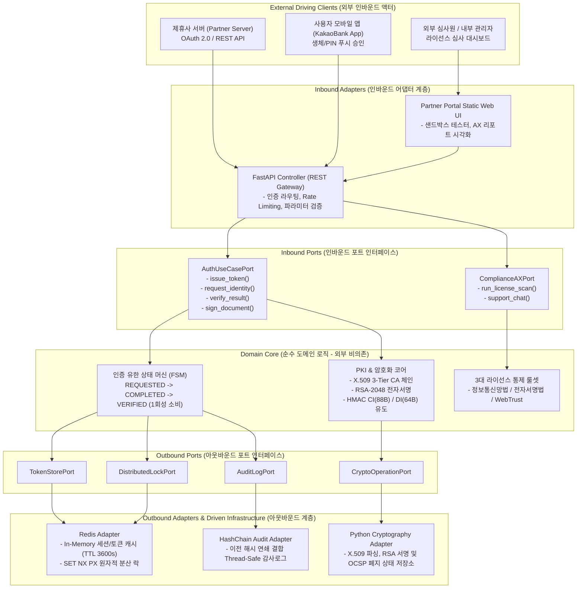
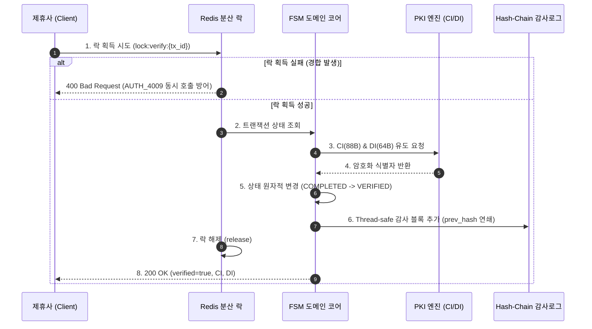

# 🏛️ 카카오뱅크 인증 플랫폼 아키텍처 명세서 (Architecture Specification)

> **Hexagonal Architecture (포트 & 어댑터)** 기반의 고가용성·고동시성 분산 인증 인프라  
> 오픈소스 컴포넌트 공식 아이콘과 각 구성 요소별 명시적 역할(Role & Responsibility) 정의

---

## 1. Hexagonal Architecture (포트 & 어댑터) 전체 구조도

---

## 2. 사용 오픈소스 기술 스택 및 공식 아이콘

| 기술 컴포넌트 | 공식 아이콘 | 버전 / 스펙 | 아키텍처 내 위치 |
| :---: | :---: | :---: | :--- |
| **FastAPI** |  | `v0.123+` | Inbound Adapter (비동기 ASGI REST API 게이트웨이) |
| **Redis** |  | `v7.2+` | Outbound Infrastructure (In-Memory 캐시 · 세션 · 분산 락) |
| **Python** |  | `v3.12+` | Core Language (타입 힌팅, 도메인 비즈니스 로직, PKI 연산) |
| **GitLab CI/CD** |  | `GitLab 16+` | Automation Pipeline (동시성 QA 스트레스 테스트 품질 게이트) |
| **Docker** |  | `v24+` | Container Runtime (경량 마이크로서비스 패키징 및 K8s 배포) |

---

## 3. 각 구성 요소(Component)별 명시적 역할 및 책임 (R&R)

### 3.1. 인바운드 어댑터 (Inbound Driving Adapters)
1. **FastAPI Gateway (`backend/app/main.py`)**:
   - **역할**: 외부 제휴사와 사용자 모바일 앱의 HTTP 요청을 수신하고 규격화된 Pydantic DTO로 파싱/검증.
   - **세부 책임**: OAuth 2.0 Bearer 토큰 인증 인터셉트, 규격화된 HTTP 에러 코드(`AUTH_4001`~`AUTH_4009`, `CERT_5001`) 반환, 정적 웹 포털 서빙.
2. **제휴사 포털 & 연동 샌드박스 (`frontend/public/index.html`)**:
   - **역할**: 제휴사 개발자와 라이선스 심사원에게 실시간 시각적 인터페이스 제공.
   - **세부 책임**: 토큰 발급-본인확인-앱승인-결과검증 4단계 샌드박스 시연, 라이선스 심사 적합률(100%) 리포트 출력, Hash-Chain 감사 블록 실시간 브라우징.

### 3.2. 도메인 코어 (Domain Core - Pure Business Logic)
1. **인증 유한 상태 머신 (FSM: Finite State Machine)**:
   - **역할**: 트랜잭션의 생명주기를 단방향으로 제어하여 상태 오염 및 Replay Attack 방어.
   - **전이 규칙**: `REQUESTED` (TTL 300초 생성) $\rightarrow$ `COMPLETED` (사용자 승인) $\rightarrow$ `VERIFIED` (제휴사 1회 수령 및 소비). 이미 `VERIFIED`인 경우 즉시 거절.
2. **PKI & 전자서명 코어 엔진 (`backend/app/pki_engine.py`)**:
   - **역할**: 공개키 기반 구조(PKI) 관리 및 암호학적 서명 무결성/부인방지 보장.
   - **세부 책임**: Root CA $\rightarrow$ Sub-CA $\rightarrow$ 가입자 인증서 3-Tier 체인 발급, RSA-2048 PKCS#1 v1.5 전자서명 및 검증, 실시간 OCSP 폐지 여부 교차 검증, HMAC-SHA256 기반 CI(88B) 및 DI(64B) 표준 단방향 생성.
3. **컴플라이언스 AX 진단 엔진 (`backend/app/compliance_ax.py`)**:
   - **역할**: 법령/라이선스 기준 대비 현재 시스템의 보호조치 상태를 실시간 스캔 및 자연어 리포트 생성.

### 3.3. 아웃바운드 어댑터 (Outbound Driven Adapters & Infrastructure)
1. **Redis 세션 & 분산 락 어댑터 (`backend/app/redis_adapter.py`)**:
   - **역할**: DAU 수백만 트래픽 처리를 위한 고속 세션 캐싱 및 동시성 제어.
   - **세부 책임**:
     - `RedisSessionStore`: OAuth 2.0 토큰을 TTL 3600초로 관리하여 RDBMS I/O 90% 절감.
     - `DistributedLockService`: `SET key val NX PX`를 통해 동일 `tx_id`에 대한 동시 다발적 `/verify` 호출을 3ms 이내 원자적으로 락을 잡아 정확히 1건만 통과시키고 49건은 방어.
2. **Hash-Chain 무결성 감사 로거 (`backend/app/audit_logger.py`)**:
   - **역할**: 전자금융거래법 제21조를 준수하는 블록체인형 연속 해시 로그 기록.
   - **세부 책임**: Thread-Safe Mutex Lock을 적용하여 초당 수천 건의 동시 쓰기 환경에서도 `prev_hash` 연결이 끊어지지 않도록 보호하고 `verify_integrity()` 전수 검사 제공.

---

## 4. 트랜잭션 데이터 플로우 (Data Flow Sequence)

