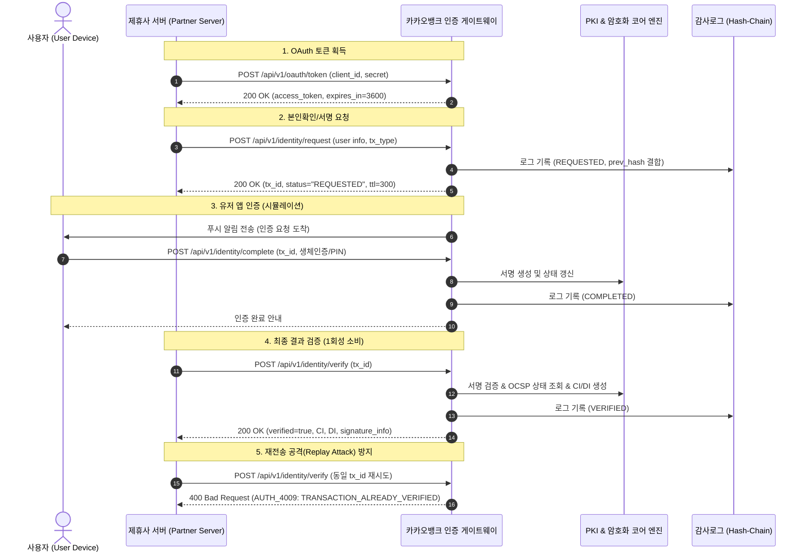

# 📌 제품 요구사항 정의서 (PRD: Product Requirements Document)

## 1. 개요 (Overview)
- **프로젝트명**: 차세대 카카오뱅크 통합 인증 서비스 & 제휴사 API 포털 (Auth Project)
- **타겟 조직**: 카카오뱅크 인증센터팀
- **목적**:
  1. 외부 제휴사(공공기관, 핀테크, 커머스 등)를 대상으로 안전하고 빠른 본인확인 및 전자서명 API 서비스 제공
  2. 제휴사 개발자/관리자를 위한 셀프 온보딩, API Key 관리, 샌드박스 테스트베드, 실시간 트래픽 대시보드 포털 구축
  3. 본인확인기관 · 전자서명인증사업자 · 웹트러스트(WebTrust) 인증 라이선스 유지 및 심사 대응을 위한 AI 기반 컴플라이언스(AX) 체계 수립

---

## 2. 사용자 및 이해관계자 정의 (User Personas)
1. **제휴사 개발자 (Partner Developer)**:
   - 신속하고 명확한 API 운영 매뉴얼 및 인터랙티브 샌드박스를 통해 에러 없이 인증 연동을 완료하고자 함.
2. **제휴사 관리자 (Partner Business Admin)**:
   - 인증 호출량, 성공률, 과금/정산 내역을 투명하게 모니터링하고 애플리케이션 보안 설정(허용 IP 등)을 관리함.
3. **인증센터 내부 운영자/컴플라이언스 담당자 (Internal Compliance Officer)**:
   - 전자서명법, 정보통신망법, 전자금융거래법 준수 여부를 상시 점검하고 라이선스 정기/수시 심사 증적을 원클릭으로 추출하고자 함.
4. **일반 엔드유저 (End User)**:
   - 제휴사 사이트에서 카카오뱅크 앱 푸시/간편인증을 통해 안전하고 끊김 없이 본인확인 및 전자서명을 수행함.

---

## 3. 핵심 기능 요구사항 (Functional Requirements)

### 3.1. 제휴사 인증 API 서비스 (Core Auth API)
- **FR-AUTH-01 (OAuth 2.0 Client Credentials)**:
  - 제휴사의 `client_id`, `client_secret`을 검증하여 유효시간(3600초)의 JWT Access Token 발급.
- **FR-AUTH-02 (본인확인 요청 및 검증 - Identity Verification)**:
  - 제휴사가 사용자의 휴대폰번호/생년월일 기반으로 인증 요청 생성 (`tx_id`, TTL 300초).
  - 유저 앱 승인 후 제휴사가 1회에 한해 본인확인 결과(`name`, `birthday`, `gender`, `CI`, `DI`) 조회.
  - 연계정보(CI): 88 Byte Base64 규격 (기관 마스터키 + 주민번호 해시 기반 HMAC-SHA256).
  - 중복가입확인정보(DI): 64 Byte Base64 규격 (CI + 제휴사 식별자 기반 HMAC-SHA256).
- **FR-AUTH-03 (전자서명 요청 및 검증 - Digital Signature)**:
  - 제휴사가 원문 데이터(Plain Text / Document Hash) 서명 요청.
  - 가입자 개인키(X.509 End-Entity) 기반 서명 생성.
  - 제휴사의 서명 검증 요청 시 PKI 서명값 무결성 + 인증서 체인 유효성 + 실시간 OCSP 상태를 교차 검증하여 결과 반환.

### 3.2. 제휴사 포털 사이트 (Partner Portal)
- **FR-PORTAL-01 (제휴사 온보딩 및 앱 관리)**:
  - 제휴사 등록, API Key(`Client ID`, `Client Secret`) 생성 및 재발급.
  - API 호출 허용 IP 화이트리스트 등록/관리.
- **FR-PORTAL-02 (라이브 샌드박스 - Interactive API Testbed)**:
  - 실제 API 서버에 연결된 테스트 환경에서 토큰 발급 → 본인확인 요청 → 앱 승인 시뮬레이션 → 검증 전 단계를 GUI에서 테스트.
  - 각 단계별 Request/Response 전문(JSON) 및 서명값, 디코딩 데이터 실시간 표시.
- **FR-PORTAL-03 (인터랙티브 API 운영 매뉴얼)**:
  - 엔드포인트별 파라미터, 헤더 암호화 규격, 에러 코드 표 및 샘플 코드(Python, cURL, JavaScript) 제공.
- **FR-PORTAL-04 (트래픽 & 감사 대시보드)**:
  - 일별/시간별 인증 요청 수, 성공률, 실패 원인 분석, 블록체인형 해시체인 감사로그 실시간 조회.

### 3.3. 컴플라이언스 & 라이선스 AX (AI Transformation) 센터
- **FR-AX-01 (라이선스 심사 AI 자동 진단 리포트)**:
  - 전자서명법, 본인확인기관 지정기준, WebTrust 원칙 기준 대비 현재 시스템 상태(암호화 강도, OCSP 응답, 감사로그 무결성 등)를 자동 스캔하여 합격/보완 리포트 생성.
- **FR-AX-02 (제휴사 기술지원 AI 어시스턴트)**:
  - 제휴사 개발자가 에러 코드(`AUTH_4009`, `CERT_4003` 등) 및 연동 규격 문의 시 RAG/컨텍스트 기반으로 즉각적인 트러블슈팅 가이드 제시.

---

## 4. 인증 트랜잭션 플로우 (End-to-End Sequence Diagram)

---

## 5. 비기능적 요구사항 (Non-Functional Requirements)
1. **보안성 (Security)**:
   - 서명 알고리즘: RSA-2048 이상 또는 ECDSA P-256 사용.
   - 데이터 해시: SHA-256 표준 준수.
   - 감사로그 무결성: 이전 레코드의 해시값을 포함하는 해시 체인 구조 채택으로 임의 변조 방지.
2. **신뢰성 & 가용성 (Reliability & Availability)**:
   - 인증 요청의 멱등성(Idempotency) 보장 및 TTL 만료 시 즉시 무효화.
   - 단방향 상태 머신 전이를 통한 상태 오염 방지.
3. **규제 준수 (Regulatory Compliance)**:
   - 전자서명법 제14조(전자서명생성정보 등의 보호), 본인확인기관 지정 등에 관한 기준 제2-1조 충족.
