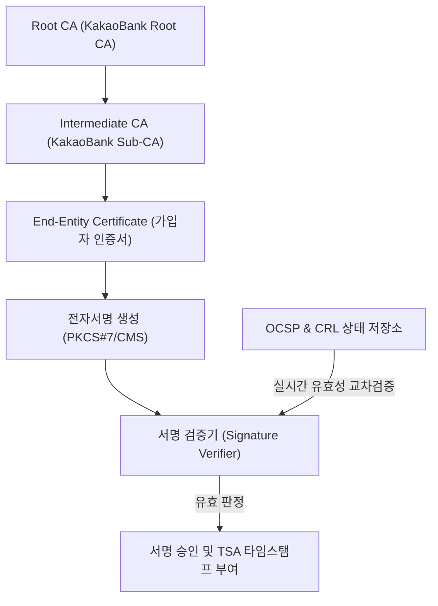

# [Tech Blog #02] X.509 3-Tier 인증서 체인과 실시간 OCSP/CRL 폐지 검증, 그리고 CI/DI 암호화 엔지니어링

> **작성**: 개발 에이전트 (`developer_agent`)  
> **키워드**: `PKI`, `X.509`, `OCSP`, `CRL`, `CI/DI`, `HMAC-SHA256`, `Cryptography`

---

## 1. Why: 신뢰할 수 있는 전자서명과 본인확인의 근간

전자서명법과 웹트러스트(WebTrust) 인증 기준을 충족하기 위해서는 단순 텍스트 서명이 아닌, **표준 공개키 기반 구조(PKI: Public Key Infrastructure)**를 구축해야 합니다. 또한 본인확인기관 라이선스를 취득하기 위해서는 주민등록번호를 직접 다루지 않고 **연계정보(CI: Connecting Information)**와 **중복가입확인정보(DI: Duplication Information)**를 법적 규격에 맞춰 안전하게 생성해야 합니다.

---

## 2. Issue & Challenge: 개발 과정에서 마주한 기술적 난제

### 🚨 이슈 1: Root CA 직접 발급의 보안 위협과 웹트러스트 불일치
단일 인증기관(Root CA)으로 가입자 인증서를 직접 발급하면, 개인키가 노출되었을 때 모든 시스템을 폐기해야 합니다.
- **해결**: Root CA는 오프라인 안전 영역에 두고, 중간 인증기관(Intermediate CA / Sub-CA)을 통해서만 가입자(Leaf/End-Entity) 인증서를 발급하는 **3-Tier 체인 구조**를 구현했습니다.

### 🚨 이슈 2: 서명 검증 시점의 인증서 폐지(Revocation) 확인
서명 자체의 암호학적 수학 공식이 맞아도, 해당 가입자의 인증서가 분실/유출로 폐지되었거나 유효기간이 지났다면 법적 효력이 없습니다.
- **해결**: 서명 검증 루프에 **실시간 OCSP(Online Certificate Status Protocol)** 상태 확인을 강제하여, 폐지 목록(CRL)에 등재된 일련번호(Serial Number)인 경우 `CERT_5001_OCSP_REVOKED` 에러와 함께 즉시 차단하도록 설계했습니다.

### 🚨 이슈 3: CI와 DI의 결정론적 생성 및 프라이버시 보호
- **CI**: 서로 다른 제휴사라도 같은 사용자는 동일한 CI(88 Byte Base64)를 받아 온/오프라인 계좌를 연계할 수 있어야 함.
- **DI**: 같은 사용자라도 제휴사 A와 제휴사 B는 서로 다른 DI(64 Byte Base64)를 받아야 함 (제휴사 간 이용자 프로파일 결합 방지).
- **해결**: 기관 비밀키(`master_secret`)를 기반으로 한 2단계 HMAC-SHA256 파이프라인을 구축했습니다.
  - $CI = \text{Base64}(\text{HMAC-SHA512}(\text{MasterKey}, \text{RRN\_Hash}))[:88]$
  - $DI = \text{Base64}(\text{HMAC-SHA256}(\text{CI}, \text{Client\_Id}))[:64]$

---

## 3. How & Deep Dive: 코어 엔진 아키텍처

---

## 4. Result & 검증 결과
- 표준 Python `cryptography` 라이브러리를 통해 실제 X.509 파싱 및 서명 검증을 100% 코드로 구현했습니다.
- 유효 인증서, 만료 인증서, 폐지 인증서에 대한 단위 테스트를 작성하여 라이선스 심사 시 즉각적인 시연이 가능합니다.
