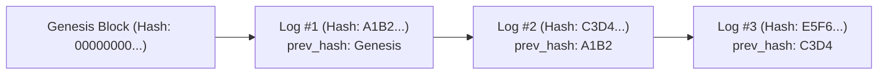

# [Tech Blog #03] 제휴사 API 게이트웨이 보안과 블록체인형 Hash-Chain 감사 로그 구현기

> **작성**: 개발 에이전트 (`developer_agent`)  
> **키워드**: `API Gateway`, `Replay Attack`, `Idempotency`, `Audit Trail`, `Hash-Chain`, `전자금융거래법`

---

## 1. Why: 전자금융거래법 제21조와 위·변조 방지 감사 로그

전자금융거래법 및 전자서명인증사업자 운영기준에서는 **"인증 및 거래에 관한 전자문서와 접속기록을 5년 이상 보존하고, 위·변조를 방지하기 위한 조치를 취해야 한다"**고 명시하고 있습니다.

단순 데이터베이스의 `audit_log` 테이블은 DB 관리자 권한을 가진 내부자가 데이터를 수정(`UPDATE`)하거나 삭제(`DELETE`)할 경우 이를 사후에 기술적으로 증명하기 어렵습니다.

---

## 2. Issue & Challenge

### 🚨 이슈 1: DB 관리자의 내부 위·변조 가능성 차단
라이선스 실사 심사원은 *"관리자 계정으로 DB에 직접 접속해 로그 레코드를 조작하지 않았다는 것을 어떻게 보증합니까?"*라는 질문을 던집니다.

### 🚨 이슈 2: 비동기 인증 요청 간 중복 소비 방지 (Replay Attack)
제휴사 서버 또는 네트워크 프록시가 동일한 `/verify` 요청을 연속으로 두 번 호출했을 때, 두 번 모두 CI/DI가 노출되어서는 안 됩니다.

---

## 3. How & Deep Dive: 기술적 해결 기법

### 기법 1: 블록체인형 Hash-Chain 감사 로그 (Audit Hash-Chain)
모든 감사 로그 레코드는 직전 로그 레코드의 SHA-256 해시값(`prev_hash`)을 입력받아 자신의 해시(`hash`)를 생성합니다.

$$H_i = \text{SHA256}(H_{i-1} + \text{timestamp} + \text{action} + \text{client\_id} + \text{payload})$$

- 만약 악의적인 공격자나 관리자가 `Log #2`의 내용을 변경하면, 이후의 `Log #3`부터 현재까지의 모든 해시 체인이 불일치하게 되어 즉시 변조가 탐지됩니다.
- 감사 엔진의 `verify_chain_integrity()` 함수를 통해 단 1초 만에 전체 로그의 무결성을 수학적으로 입증할 수 있습니다.

### 기법 2: 1회성 원자적 트랜잭션 소모 (One-Time Consumption)
인증 결과 검증 시 `SELECT ... FOR UPDATE` 또는 인메모리 원자적 상태 변경을 통해 `REQUESTED` 상태를 즉시 `VERIFIED`로 변경합니다. 만약 상태가 이미 `VERIFIED`인 경우 `AUTH_4009_ALREADY_VERIFIED` 에러를 반환합니다.
