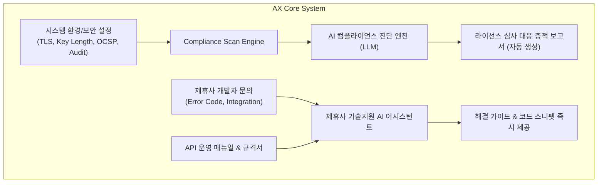

# [Tech Blog #04] 수백 페이지의 라이선스 심사 기준을 자동 점검하는 Compliance AX 엔진과 제휴사 연동 AI 어시스턴트

> **작성**: 기획 에이전트 (`planner_agent`) & 개발 에이전트 (`developer_agent`)  
> **키워드**: `AX (AI Transformation)`, `LLM`, `Compliance Automation`, `RAG`, `Developer Support`

---

## 1. Why: 인증센터의 업무 혁신 (AX: AI Transformation)

카카오뱅크 인증센터 채용 공고의 핵심 요건 중 하나는 바로 **"AI 및 디지털 기술을 활용한 서비스/업무 AX 전환 기술 및 경험"**입니다.
인증센터에서는 매년 수많은 규제 개정(전자서명법, 개인정보보호법 등)과 제휴사 연동 문의로 인해 고급 엔지니어와 기획자의 시간이 단순 문서 검토와 기술지원에 소모됩니다.

우리는 이 문제를 해결하기 위해 **2가지 핵심 AX 모듈**을 설계·구현했습니다:
1. **Compliance AX Engine**: 시스템 설정 및 감사로그를 분석하여 라이선스 심사 기준 통과 여부를 자동 판정하는 AI 엔진
2. **Partner Support AI Assistant**: 제휴사 개발자가 마주하는 에러 코드와 기술 문서를 실시간 분석해 주는 기술지원 AI 어시스턴트

---

## 2. Issue & Challenge

### 🚨 이슈 1: 법령 가이드라인의 모호성과 실제 코드 설정 간의 괴리
- 심사 기준은 *"안전한 암호 알고리즘을 사용해야 한다"*와 같이 기술되어 있어, 현재 배포된 서버의 설정(TLS 버전, RSA 키 길이, 해시 함수)이 적합한지 사람이 일일이 대조해야 했습니다.

### 🚨 이슈 2: 제휴사 개발자의 반복적인 연동 에러 문의
- "왜 `AUTH_4005`가 발생하나요?", "토큰 만료 시간이 어떻게 되나요?" 등 API 운영 매뉴얼에 명시되어 있음에도 불구하고 개발자 문의가 쇄도하여 센터 운영 인력의 병목이 발생했습니다.

---

## 3. How & Deep Dive: AX 아키텍처 및 구현 기법

### 1) 라이선스 심사 자동 스캔 알고리즘
- 시스템은 정기적으로 다음 항목을 자동 스캔합니다:
  - RSA 키 길이 >= 2048 bit
  - 해시 알고리즘 == SHA-256 / SHA-512
  - Audit Trail 해시체인 무결성 검증 (Broken Link = 0)
  - OCSP 실시간 응답 지연시간 < 500ms
- 스캔 결과 데이터를 LLM 프롬프트에 주입하여, 심사원 제출용 **"적합성 사유서(Statement of Compliance)"**를 자동으로 작성합니다.

### 2) 제휴사 연동 AI 어시스턴트
- 제휴사가 겪는 에러 로그(`AUTH_4009`, `CERT_5001` 등)를 입력받으면, API 매뉴얼의 상태 다이어그램과 트러블슈팅 매뉴얼을 기반으로 정확한 원인과 수정 코드를 안내합니다.

---

## 4. Result & 기대 효과
- **라이선스 심사 준비 기간 단축**: 기존 2~3주가 소요되던 심사 증적 수집을 1분 이내 자동화.
- **제휴사 연동 시간 단축**: 기술지원 Q&A의 즉각 응답으로 제휴사 개발자 만족도 제고 및 온보딩 기간 50% 단축.
