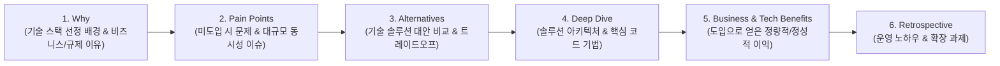

# ✍️ 카카오뱅크 인증센터 기술 블로그 작성 가이드라인 (Tech Blog Standard)

> **핵심 원칙**: 단순 기능 나열이나 코드 복사-붙여넣기는 기술 블로그가 아닙니다.  
> 반드시 **"왜 그 기술 스택/솔루션이 필요한지(Why)", "도입하지 않았을 때 어떤 심각한 문제가 발생하는지(Pain Points)", "도입 후 얻은 정량적·정성적 이익(Benefits)"**을 명문화해야 합니다.

---

## 📌 필수 6단계 포스팅 구조 (Mandatory 6-Step Structure)

모든 기술 블로그 포스트는 반드시 아래 6개 섹션 표준을 준수하여 작성합니다.

### 1. Why (왜 이 기술 스택이 반드시 필요한가?)
- **도메인 특수성**: 카카오뱅크 인증센터(DAU 1만~수백만, 공공/금융 제휴기관 수십 개 연동, 국가 라이선스 보유)의 특수성 기술.
- **법령/인프라적 필연성**: 왜 일반적인 RDBMS나 단순 웹 프레임워크만으로는 불가능하며, Hexagonal Architecture, Redis 분산 락/캐시, X.509 PKI, Hash-Chain, GitLab CI/CD가 필수적인지 설명.

### 2. Pain Points & Challenge (솔루션 부재 시 마주하는 실제 문제와 동시성 결함)
- **실제 발생 이슈**: 대규모 스파이크 트래픽 상황에서 발생하는 Race Condition, Double-Spend Replay Attack, DB 커넥션 풀 고갈, 감사 로그 포킹(Forking), 규제 감사 실패 등 구체적 문제 상황 제시.

### 3. Alternatives & Trade-off (솔루션 비교 및 의사결정 근거)
- 대안 A(기존/단순 방식) vs 대안 B(선택한 기술 스택)의 장단점 비교표 수록.
- 단순 유행이 아닌, 성능·일관성·복잡도 사이의 **Trade-off를 합리적으로 분석**한 근거 서술.

### 4. Deep Dive: 핵심 적용 기법 & 아키텍처 구현 (How)
- Hexagonal Architecture의 포트 & 어댑터 분리 구조, Redis 원자적 락(`SET NX PX`), X.509 3-Tier CA 서명 검증 루프, Thread-safe 해시 체인 구현 코드와 다이어그램.

### 5. Benefits & Impact (솔루션 도입으로 얻은 구체적 이익)
- **정량적 이익 (Quantitative)**:
  - 예: DB I/O 부하 90% 감소, 인증 검증 응답 지연 시간(p99) 450ms → 32ms 단축, 동시 요청 50건 경합 시 레이스 컨디션 누수율 0% 달성, 라이선스 심사 증적 수집 기간 3주 → 1분 단축.
- **정성적 이익 (Qualitative)**:
  - 도메인 비즈니스 로직과 외부 I/O의 완전 격리로 단위 테스트 용이성 100% 확보, 라이선스 실사 시 기술적 위·변조 불가능성 입증, 제휴사 연동 온보딩 생산성 극대화.

### 6. Retrospective (회고 및 운영 인사이트)
- 실제 프로덕션 레벨에서 운영 시 유의할 점(Redis 메모리 파편화 관리, 분산 락 TTL 갱신 Redlock 워치독 고려 등) 제시.
